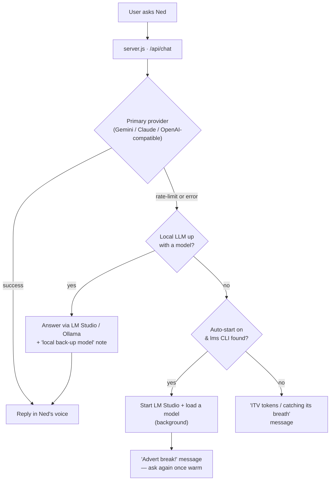

# Ask Ned 🚴‍♂️🟡

[](https://github.com/robdabell/askned/actions/workflows/ci.yml)

A small, dependency-free chatbot web app that answers questions about the
**Tour de France** in the warm, witty, self-deprecating voice of British cycling
commentator **Ned Boulting**.

- **Talk to Ned** about the jerseys, the great climbs, the history and this
  year's race.
- **Live race context** — the current year's Tour de France article is pulled
  from Wikipedia and given to the model, so Ned can talk about the race
  happening *now*, not just his training data.
- **Route visuals** — every 2026 stage, with the official
  [letour.fr](https://www.letour.fr/en/overall-route) map & elevation profile
  embedded in the app (optional VeloViewer 3D route per stage).
- **Latest sources** — a curated list of trusted cycling news, results and
  broadcast sources, surfaced in the UI and cited by Ned when he doesn't hold a
  live fact.
- **Pluggable LLM** — works with Google Gemini, any OpenAI-compatible endpoint
  (Groq, Ollama, …), Anthropic Claude, or a built-in offline responder.

## Requirements

- Node.js **>= 20.12** (uses the built-in `http`, global `fetch`, and the
  `--env-file-if-exists` flag; no `npm install` needed).

## Quick start

```bash
cp .env.example .env      # then edit .env to add your provider + key
npm start                 # http://localhost:3001
```

With no `.env`, the app still runs using a small **offline** responder, so you
can try the UI immediately.

## Scripts

| Command | What it does |
| --- | --- |
| `npm start` | Start the server (loads `.env` if present) → http://localhost:3001 |
| `npm run dev` | Same, with auto-reload (`--watch`) |
| `npm test` | HTTP integration tests (`node:test`) |

## Configuration

The chat "brain" auto-selects a provider based on environment variables
(see [`.env.example`](.env.example) for ready-to-use blocks):

| Provider | How to enable |
| --- | --- |
| **Google Gemini** (free tier) | `OPENAI_BASE_URL=https://generativelanguage.googleapis.com/v1beta/openai`, `OPENAI_API_KEY`, `OPENAI_MODEL=gemini-flash-latest` |
| **Groq / Ollama / other** | Any OpenAI-compatible `OPENAI_BASE_URL` (+ `OPENAI_API_KEY`, `OPENAI_MODEL`) |
| **Anthropic Claude** | `ANTHROPIC_API_KEY` (+ optional `ANTHROPIC_MODEL`) |
| **Offline** | Set nothing — built-in canned responder |

### Local LLM fallback (free, offline)

If the primary provider is **rate-limited or errors**, the app automatically
retries a **local model** over a local OpenAI-compatible server before showing
Ned's "catching its breath" message. Works with either:

- **LM Studio** — load a model and start its *Local Server* (Developer tab).
  Default URL `http://localhost:1234/v1`.
- **Ollama** — `ollama serve` + `ollama pull llama3.2`, then set
  `LOCAL_LLM_URL=http://localhost:11434/v1`.

The model is **auto-detected** from whatever the local server has loaded (set
`LOCAL_LLM_MODEL` to pin one). Disable with `LOCAL_LLM_FALLBACK=0`.

**Auto-start:** if the primary is down and LM Studio isn't running, the app will
try to start it (via the `lms` CLI) and load a model in the background, covering
the gap with an "advert break" message — ask again once it's warmed up. Disable
with `LOCAL_LLM_AUTOSTART=0`.

### Sharing on your network

By default the server binds to all interfaces, so others on your LAN can reach it
at `http://<your-ip>:3001` (the startup log prints the address). There is **no
authentication** — anyone who can reach it uses your API quota / local model, so
only share on trusted networks. Set `HOST=127.0.0.1` to restrict to this machine.

Other vars: `PORT` (default `3001`), `HOST` (default `0.0.0.0`).

> **Never commit `.env`** — it holds your API key and is gitignored. Rotate any
> key that has been shared or exposed.

## Architecture — the fallback chain

Every `POST /api/chat` runs through a resilience chain so a rate-limited free
tier never leaves Ned speechless:



Alongside this, every reply is grounded with **live context**: the current
year's Tour de France article (Wikipedia), the official 2026 stage list
(letour.fr) and the curated source list — all injected into Ned's system prompt.

## Project layout

| File | Purpose |
| --- | --- |
| `server.js` | HTTP server + routes (`/`, `/api/chat`, `/api/stages`, `/api/sources`) |
| `chat.js` | LLM provider selection + calls (Gemini / OpenAI-compatible / Anthropic / offline) |
| `persona.js` | Ned Boulting system prompt + offline fallback responder |
| `race-context.js` | Fetches the current year's Tour de France article (Wikipedia) for live context |
| `stages-2026.js` | Official 2026 stage list (from letour.fr) + route assets |
| `sources.js` | Curated cycling news / data / broadcast sources |
| `index.html` | Front-end: chat UI, route visuals panel, sources panel |
| `server.test.js` | HTTP integration tests |

## Notes & limitations

- Live race data is only as fresh/accurate as the Wikipedia article and the
  official site; granular figures (exact time gaps mid-stage) won't be present.
- Free LLM tiers are rate-limited — when the quota is hit, Ned says so in
  character rather than erroring.
- The `letour.fr` stage embed relies on that site continuing to allow framing.
